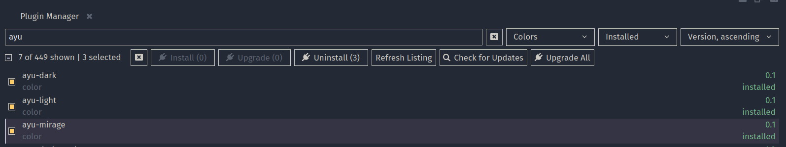
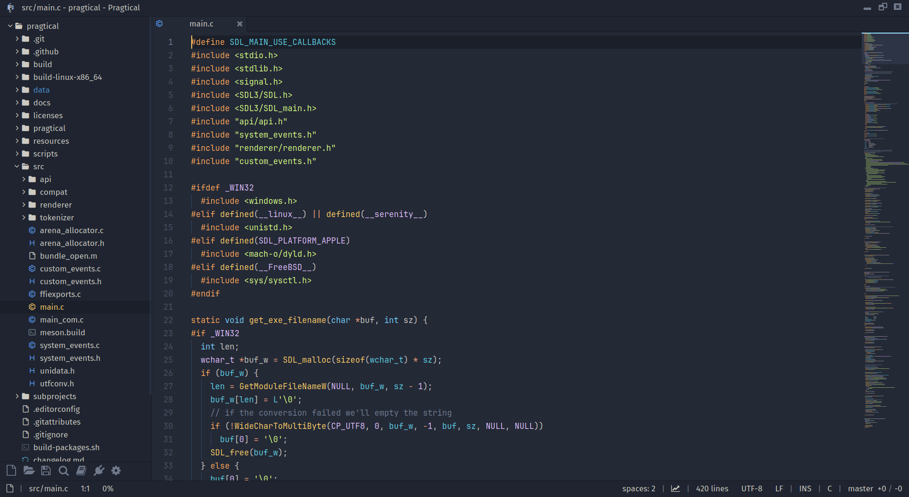
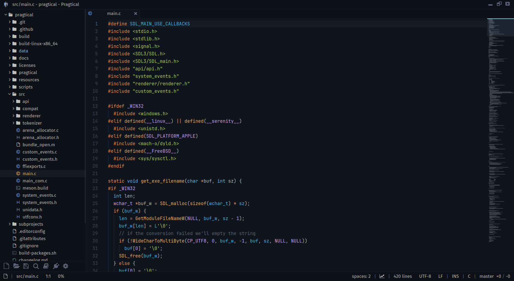
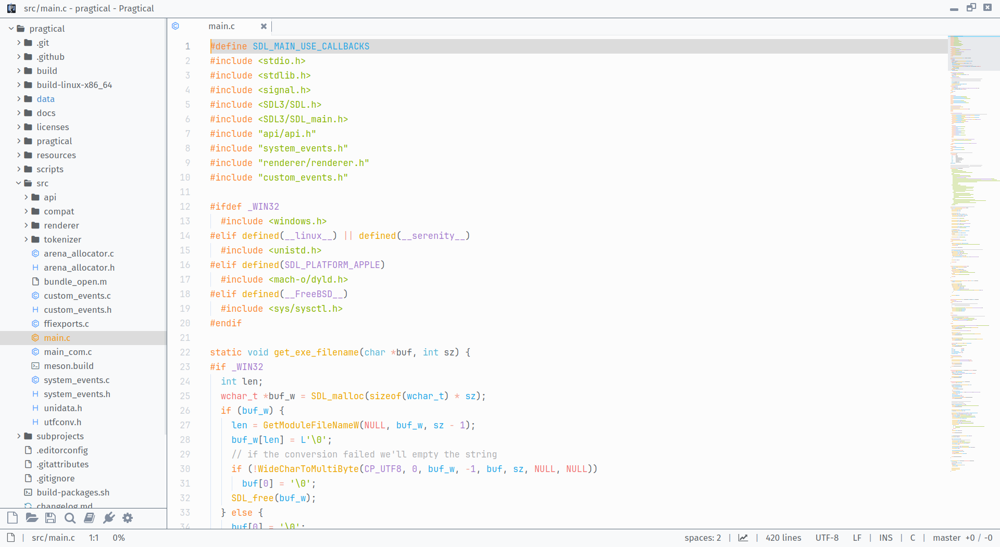

# Ayu Theme for Pragtical

A port of the beautiful [dempfi's Ayu Theme](https://github.com/dempfi/ayu) for [Pragtical editor](https://github.com/pragtical/pragtical).

> `ayu` is a simple theme with bright colors and comes in three versions — *dark*, *mirage* and *light* for all day long comfortable work.

## Instalation
### 1. Pragtical Plugin Manager (Recommended)
#### From Command Line
You can install Ayu Theme just by running this command from command line/terminal :
```bash
pragtical pm install ayu-light ayu-dark ayu-light
```

#### From User Interface
1. In Pragtical, open the Command Palette (`Ctrl+Shift+P` / `Cmd+Shift+P`), type `Plugin Manager: Show` and press `Enter`.
2. Search for `ayu`, checks all found entries, and click `Install`



### 2. Manual
Clone this repository to your local directory, then copy the contents of `colors` directory to `PRAGTICAL_CONFIG_DIR/colors` (in case of linux, this usually translates to `~/.config/pragtical/colors`)

```bash
git clone https://github.com/juliardi/pragtical-ayu-theme.git ayu-theme
cd ayu-theme
cp colors/* ~/.config/pragtical/colors
```

## Preview
### Ayu Mirage


### Ayu Dark


### Ayu Light

